

  

  Разработчик из Сочи. Делаю <b>Vicinity</b> — мессенджер для своих: чаты, серверы, голос и звонки.

  
  
  

<table align="center"><tr>
<td>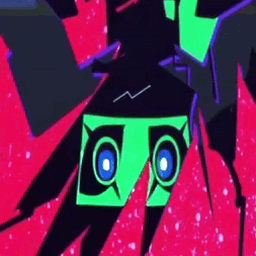</td>
<td>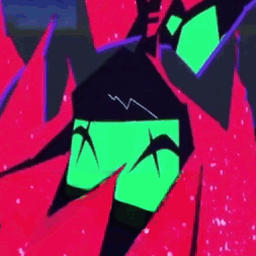</td>
<td>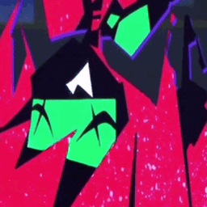</td>
<td>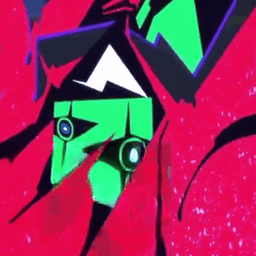</td>
<td>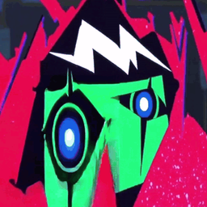</td>
<td>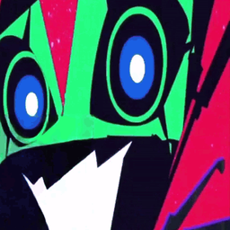</td>
<td>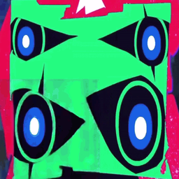</td>
<td>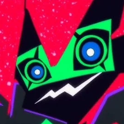</td>
</tr></table>

---

### `ЗАПУСКАЕТ  Vicinity`

Мессенджер со своим сервером: личные сообщения и беседы, серверы с текстовыми и голосовыми каналами, звонки с камерой и показом экрана. Работает в браузере, как приложение для Windows и на телефоне — с одним аккаунтом везде.

- 🟥 **Голос и звонки** — голосовые каналы, WebRTC-звонки, показ экрана до 1440p 60 к/с (в приложении — со звуком компьютера)
- 🟩 **Безопасность** — двухфакторная аутентификация, подтверждение почты, капча ALTCHA, список активных сеансов
- 🟪 **Оформление** — темы, стили ника, тема профиля с автоматическим контрастом, 20 значков приложения
- ⬛ **Своё развёртывание** — Docker Compose, TURN-сервер, резервные копии и обновление одной командой

→ [Репозиторий](https://github.com/inkoffTTV/Vicinity) · [Релизы](https://github.com/inkoffTTV/Vicinity/releases)

### `ВСЕЛЯЕТСЯ В  capri-desktop-russ`

<a href="https://github.com/inkoffTTV/capri-desktop-russ">
  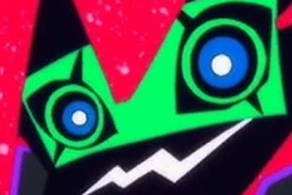
</a>

**[capri-desktop-russ](https://github.com/inkoffTTV/capri-desktop-russ)** — русская редакция десктопной Капри.
Она сидит на твоих окнах, телепортируется к мыши, когда Claude Code, Codex или Antigravity
ждут разрешения, глитчит при ошибке и сходит с ума от радости, когда задача выполнена.
Без подписок говорит с тобой через локальную модель (Ollama, LM Studio, llama.cpp).

  
  

 

### `ИЩЕТ  "stack"`

  
  
  
  
  
  
  
  
  
  

### `ОТЧЁТ О МИССИЯХ`

  
  

  

  

  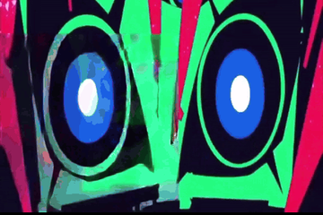
  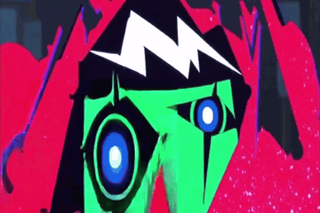
  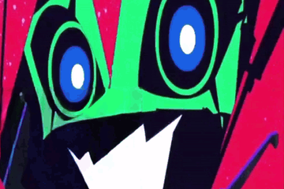
  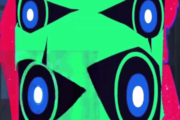

  <b>Связь:</b> Telegram <a href="https://t.me/outfxxxtd">@outfxxxtd</a>

---

  Capri / Project Capricorn, Cyberpunk и Cyberpunk: Edgerunners принадлежат CD PROJEKT RED, Studio Trigger и Netflix.
  Фанатский профиль без аффилиации. Изображения из <a href="https://github.com/inkoffTTV/capri-desktop-russ">capri-desktop-russ</a>,
  форка <a href="https://github.com/mochiiwuff/capri-desktop">mochiiwuff/capri-desktop</a> (MIT для кода).
  Фон шапки: фрагмент обоев «D &amp; Capri» от LordRango, <a href="https://wall.alphacoders.com/big.php?i=1416742">Alpha Coders</a>.

