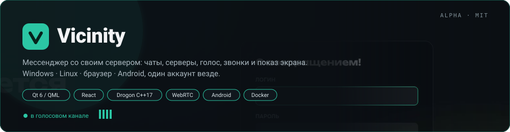
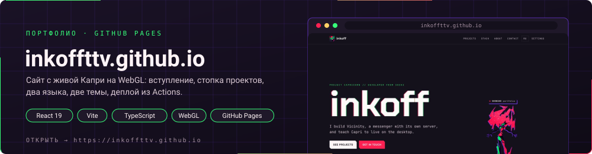

<h1 align="center">inkoff</h1>

  Разработчик из Сочи. Мессенджер со своим сервером, турнирный бот для Dota 2, конструкт на рабочем столе и сайт. 
  У каждого проекта ниже своё лицо.

  
  
  

 

**[Vicinity](https://github.com/inkoffTTV/Vicinity)** — мессенджер со своим сервером. Десктопный клиент на Qt 6/QML, веб-клиент на React, бэкенд на C++17 и Drogon, приложение для Android. Серверы с текстовыми и голосовыми каналами, личные сообщения и беседы, звонки по WebRTC с камерой и показом экрана. Один аккаунт на всех устройствах.

- **Голос и звонки** — голосовые каналы, звонки с Opus, H264 и показом экрана до 1440p 60 к/с, TURN-ретранслятор за NAT
- **Безопасность** — двухфакторная аутентификация, подтверждение почты, список сеансов, лимиты по IP и пользователю, строгая CSP
- **Своё развёртывание** — Docker Compose с бэкендом, nginx, coturn и Caddy, резервные копии и обновление одной командой

  
  
  
  
  

 

**[TI:IT TOP](https://github.com/inkoffTTV/ti-it-top)** — Telegram-бот для турниров по Dota 2 на aiogram 3 и SQLAlchemy 2. Регистрация игроков, верификация через Steam, Dotabuff и STRATZ, команды с капитанами, турниры с сетками, заявки со статусами, поддержка и полная админ-панель.

- **Верификация без отказов** — если Dotabuff или STRATZ отвечают 403, игрок уходит в `PENDING` на ручную проверку, а не отклоняется
- **Турнирный движок** — форматы, посев, серии матчей, напоминания, карточки результатов, прогнозы и дайджест
- **Надёжность** — тесты на моках без сети, диагностика API в админке, секреты только через окружение

  
  
  
  

 

**[capri-desktop-russ](https://github.com/inkoffTTV/capri-desktop-russ)** — русская редакция десктопной Капри, конструкта Project Capricorn из Cyberpunk: Edgerunners. Она сидит на окнах, телепортируется к мыши, когда Claude Code, Codex или Antigravity ждут разрешения, глитчит при ошибке и ликует, когда задача выполнена. Говорит с тобой через локальную модель без подписок.

- **Покадровая анимация** — WebGL-шейдер, 12 кадров в секунду «по двойкам», как в аниме
- **Живёт в системе** — сидит на окнах, выглядывает из-за краёв экрана, вселяется в окна
- **Своя голова** — Ollama, LM Studio, llama.cpp или ключ к облачной модели

  
  
  
  

 

**[inkoffttv.github.io](https://inkoffttv.github.io)** — сайт-портфолио на React 19 и Vite. На странице живёт Капри на том же WebGL-рендере: вступление с захватом экрана, карточки проектов как её окна, тикер над головой. Два языка, две темы, режим без анимаций, деплой на GitHub Pages из Actions.

  
  

 

  
  

  

---

  Capri / Project Capricorn, Cyberpunk и Cyberpunk: Edgerunners принадлежат CD PROJEKT RED, Studio Trigger и Netflix; изображения в блоке capri-desktop-russ из <a href="https://github.com/mochiiwuff/capri-desktop">capri-desktop</a>.
  Dota 2 и Aegis of Champions принадлежат Valve; изображение в блоке TI:IT TOP: <a href="https://wall.alphacoders.com/big.php?i=435878">Alpha Coders</a>. Фанатские проекты без аффилиации.

